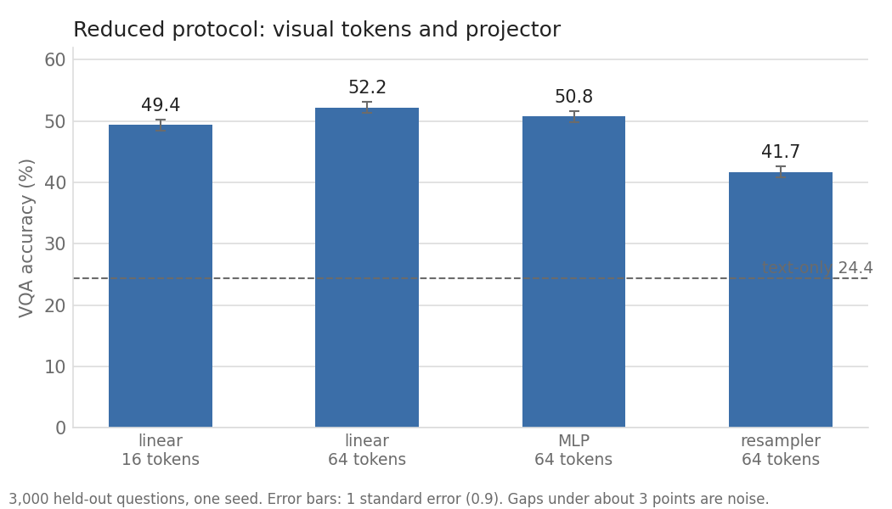
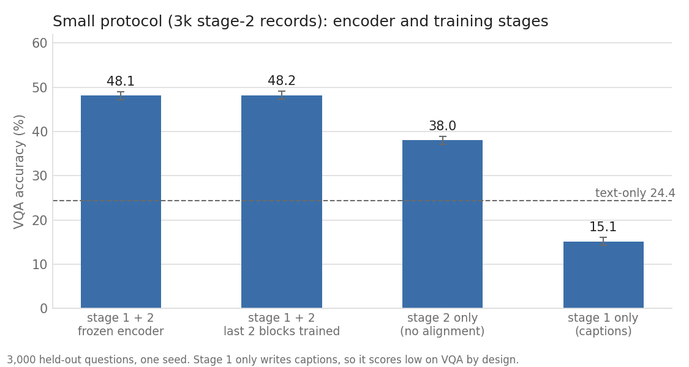

# Mini-VLM from scratch

[](https://www.python.org/)
[](https://pytorch.org/)

A small LLaVA-style vision-language model that answers questions about pictures, built to understand how the pieces
fit together. It is the sequel to my [ViT from scratch](https://github.com/RamuNalla/vit-from-scratch) project: the
image encoder is that same ViT code, loaded with CLIP ViT-B/16 weights, and glued to Qwen2.5-0.5B-Instruct through a
small learned projector. Everything was trained on one MacBook (M4 Pro, 48 GB, MPS), so the data is small and the
numbers are modest. The point was to see where the model works, where it breaks, and why.

```
who is holding the umbrella?  ->  [ image ] + question  ->  "the woman in red"
```

---

## What it scores

Evaluated on 3,000 questions about 1,000 held-out COCO images (VQAv2 soft accuracy):

| System | VQA accuracy |
|---|---|
| Always answer "yes" | 24.7% |
| Same language model, no image | 24.4% |
| **Mini-VLM (this repo)** | **57.4%** |

After the first training stage the model also writes decent captions (CIDEr 0.95 on the 1,000 held-out images). The
second stage teaches it to answer in one or two words, and it forgets how to write long captions: CIDEr drops to 0.27.
I kept both numbers because they show what each stage does.

The training set is deliberately tiny (10k images, 20k questions) so every experiment fits on a laptop. Treat the
numbers as a lower bound for the recipe, not a benchmark.

---

## How it works

```
 image (224x224)
     │
     ▼  CLIP ViT-B/16 (my ViT code, pretrained weights, frozen), layer -2, CLS token dropped
 196 patch tokens x 768
     │
     ▼  average-pool the 14x14 grid down to 8x8
 64 tokens x 768
     │
     ▼  projector (one linear layer, 0.69M parameters)
 64 tokens x 896
     │
     ▼  written over the <|image_pad|> positions of the prompt embeddings
 Qwen2.5-0.5B-Instruct (+ LoRA adapters in stage 2)
     │
     ▼
 "blue"
```

The prompt is Qwen's chat template with the picture marked as a run of `<|image_pad|>` tokens between
`<|vision_start|>` and `<|vision_end|>`. At those positions the text embeddings are replaced by the projected image
tokens, and the language model reads the whole thing as one sequence. Only the answer tokens count towards the loss.

Training happens in two stages:

1. **Align.** Only the projector is trained, on COCO captions. The language model has to learn to read image tokens
   without its weights changing, so this stage is about getting the two embedding spaces to line up.
2. **Instruct.** The projector and LoRA adapters (rank 16, all attention and MLP layers, 8.8M parameters) are trained on
   VQAv2 questions, with the instruction to answer briefly.

---

## Repository layout

```text
mini-vlm-from-scratch/
├── configs/
│   ├── stage1_align.yaml           # captions -> projector
│   ├── stage2_instruct.yaml        # VQA -> projector + LoRA
│   └── experiments/                # one small YAML per Phase 5 variant
├── docs/
│   ├── data.md                     # how the data subset is built
│   ├── phase2_results.md           # encoder check against Hugging Face CLIP
│   ├── phase4_results.md           # baselines and the first full run
│   ├── phase5_results.md           # the experiments (tokens, projector, encoder, stages, latency)
│   ├── phase6_analysis.md          # failure analysis
│   └── assets/                     # plots
├── notebooks/
│   ├── 01_encoder_verification.ipynb
│   ├── 02_data_inspection.ipynb
│   └── 03_failure_analysis.ipynb
├── scripts/                        # download_data, extract_features, evaluate, demo, run_experiments, ...
├── src/
│   ├── models/
│   │   ├── vit/                    # the ViT from the previous project, plus CLIP loading
│   │   ├── projectors.py           # linear, MLP and Q-Former-style resampler
│   │   ├── language_model.py       # Qwen wrapper, freezing, LoRA
│   │   └── vlm.py                  # image tokens -> prompt embeddings -> generation
│   ├── data/                       # datasets, chat template and label masking, collator, feature cache
│   ├── engine/                     # trainer, evaluator, checkpoint loading, inference
│   ├── eval/                       # VQA accuracy, BLEU and CIDEr, latency timing
│   └── analysis/                   # question groups and the language-prior baseline
└── tests/                          # 260 tests
```

---

## Running it

```bash
git clone https://github.com/RamuNalla/mini-vlm-from-scratch.git
cd mini-vlm-from-scratch
python -m venv venv && source venv/bin/activate
pip install -r requirements.txt
```

**1. Build the data subset** (downloads COCO captions and VQAv2 questions, 10k train images and 1k eval images):

```bash
python scripts/download_data.py
```

**2. Cache the encoder features.** The encoder is frozen, so its output is computed once (3.3 GB on disk) and every
training step skips the image pipeline:

```bash
python -m scripts.extract_features
```

**3. Train both stages** (about 2.5 hours on an M4 Pro; the first runs the 3 epochs of captions, the second the 2 epochs
of VQA):

```bash
python -m src.train --config configs/stage1_align.yaml
python -m src.train --config configs/stage2_instruct.yaml
```

Checkpoints go to `checkpoints/` (ignored by git). A run that is interrupted continues with `--resume
checkpoints/<run>/last.pt`.

**4. Evaluate:**

```bash
python -m scripts.evaluate --name stage2 --checkpoint checkpoints/stage2_instruct/best.pt
python -m scripts.evaluate --name text_only --text-only      # the no-image baseline
```

**5. Ask it something:**

```bash
python -m scripts.demo --image photo.jpg -q "What color is the car?" -q "How many people are there?"
python -m scripts.demo --image photo.jpg --caption --checkpoint checkpoints/stage1_align/best.pt
```

**6. Run the experiments and tests:**

```bash
python -m scripts.run_experiments --variant configs/experiments/ref.yaml    # ~50 min per variant
python -m scripts.summarize                                                 # one results table
pytest tests/
```

If your machine has no internet while a run starts, set `HF_HUB_OFFLINE=1` (the models must already be cached).

---

## What I tried

All variants share one reduced recipe (1 epoch per stage, 10k VQA questions, about 50 minutes each) so I could afford
to compare them. Each is one seed, and the noise on 3,000 questions is about 1 point, so I only trust gaps over
about 3 points. Details and caveats are in [docs/phase5_results.md](docs/phase5_results.md).



- **How many image tokens?** 64 tokens got 52.2%, 16 tokens 49.4%. That is close to the noise, but 16 tokens are about 40%
  faster when answering in batches. I stopped at two points: the 196-token run was too slow for my laptop.
- **Which projector?** A single linear layer (52.2%) did as well as a two-layer MLP (50.8%). A Q-Former-style resampler
  scored 41.7%, but its captions were also bad, so I think it was under-trained in this budget. I did not re-run it.
- **Train the encoder too?** Unfreezing the last two CLIP blocks changed nothing (48.2% against 48.1%) and costs 14M more
  trainable parameters.
- **Is the first stage needed?** Yes. Skipping it costs about 10 points (38.0% against 48.1%), though part of that may be
  a learning rate that was tuned for an already aligned projector.



---

## Where it fails

Full write-up: [docs/phase6_analysis.md](docs/phase6_analysis.md), plus a notebook
([03_failure_analysis.ipynb](notebooks/03_failure_analysis.ipynb)) with the charts and examples.

Accuracy by question type for the main model, against the same model with no image:

| | counting | colour | spatial | yes/no | other |
|---|---|---|---|---|---|
| no image | 13.2 | 26.1 | 12.7 | 42.8 | 11.4 |
| Mini-VLM | 43.8 | 53.6 | 41.3 | 79.4 | 44.2 |

- **It does use the image.** Giving it a different picture changes 63% of its answers and costs 23 points. Giving it an
  empty one costs 17. A wrong picture is worse than none, so it follows what it sees.
- **Counting is mostly under-counting.** In 321 numeric answers it was too low 148 times and too high 54 times. It is
  right about two-thirds of the time for one object, a third for three and rarely above four.
- **Colour goes to the bigger neighbour.** In the examples I read, the boat is "blue" because of the water and the red
  hat is "black" because of the shirt.
- **It cannot read.** It invents a plausible word for train names and signs at 224 pixels.
- **Part of the score is the question.** Guessing from the question type alone gets 66% on yes/no and 34% on counting,
  so the image adds less there than the headline gains suggest.

These come from reading about 30 failures by hand and from the ablation, so the causes are readings, not proofs.

---

## Things worth knowing

- **The encoder matches Hugging Face CLIP exactly.** The ViT code from my earlier project needed QuickGELU, a patch bias, a
  pre-norm and position-embedding interpolation to load CLIP's weights. A test checks the outputs against the Hugging Face
  model, so every later problem can be blamed on something else.
- **Generation from embeddings needed a fix.** Qwen's default repetition penalty of 1.1 turns the first generated token
  into garbage when decoding from `inputs_embeds`, so the VLM overrides it. A regression test keeps it that way.
- **Pooling is a matrix multiplication.** MPS cannot run adaptive average pooling when the sizes do not divide evenly, so
  the pooling is done with a small matrix, which matches PyTorch to about 1e-7.
- **Long runs are resumable.** The experiment runner skips finished stages, resumes interrupted ones from `last.pt` and
  checks every exit code. I added the last part after a run died while the shell reported success.
- **Scoring matches the official VQA rules,** with a small extra answer normalisation ("four" and "4" count as the same
  answer), which is the default here and is noted wherever it matters.

## Limits

One seed per experiment. A small data subset and 224 pixel images. The question groups are rough text rules. The
resampler result says more about my training budget than about resamplers. The numbers in this README are from my
runs on one machine; the checkpoints are not committed (`*.pt` is ignored), so reproducing them means running the
training commands above.

## Acknowledgements

CLIP ViT-B/16 from OpenAI, Qwen2.5-0.5B-Instruct from the Qwen team, the COCO and VQAv2 datasets, the LLaVA papers
for the recipe, and the Hugging Face `transformers` and `peft` libraries. The VQA scoring and the BLEU and CIDEr code
are my own implementations, checked against the usual reference scorers.
