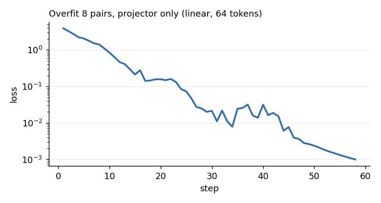

# Phase 2 Results: Language model, projectors and VLM assembly

Phase 2 connects the CLIP-loaded ViT from Phase 1 to Qwen2.5-0.5B-Instruct through a learned projector. This page records what was built, the sanity-run results, and the problems found along the way. All numbers come from a local Apple M4 Pro (48 GB, PyTorch MPS).

## What exists

| Component | File | Notes |
|---|---|---|
| Projectors | `src/models/projectors.py` | Linear (768 → 896, 0.69M params), 2-layer MLP (1.49M), resampler stub for Phase 5, `build_projector()` factory |
| Chat template + label masking | `src/data/templates.py` | ChatML; `<image>` becomes `<\|vision_start\|>` + N × `<\|image_pad\|>` + `<\|vision_end\|>`; loss only on assistant replies and their `<\|im_end\|>` |
| Language model wrapper | `src/models/language_model.py` | Loads Qwen, `freeze()`, `apply_lora()` over all 7 attention/MLP linears (8.8M trainable at r=16) |
| VLM | `src/models/vlm.py` | Pooled ViT tokens → projector → spliced into LM `inputs_embeds`; `generate()`; stage and unfreeze controls; accepts cached ViT features |
| Toy-data helper | `scripts/fetch_toy_coco.py` | 8 COCO val images with captions |
| Overfit run | `scripts/overfit_toy.py` | Projector-only memorisation test |

Test suite: **109 tests pass** (~22 s), covering Phase 1 and Phase 2. The VLM tests include an end-to-end check that visual tokens behave exactly like word embeddings inside the LM (run on both a tiny LM and the real Qwen weights).

## Overfit sanity run

Setup: real CLIP ViT-B/16 and Qwen2.5-0.5B-Instruct, both frozen; linear projector; 64 visual tokens; fp32; 8 image-caption pairs; AdamW, lr 1e-3, batch of all 8 pairs; cached ViT features.



| | |
|---|---|
| Loss | 3.92 (step 1) → 0.85 (10) → 0.073 (25) → 0.0024 (50) → < 1e-3 (step 58, stopped) |
| Exact caption matches after training (greedy) | **8 / 8** |
| Step time | ~0.84 s (8 × 106 tokens) |
| Device memory | 2.34 GB (allocation at end of run, not a peak) |

Example (target / untrained output / trained output):

| Target caption | Before training | After training |
|---|---|---|
| A child holding a flowered umbrella and petting a yak. | "I'm sorry, but I cannot generate or describe images. …" | A child holding a flowered umbrella and petting a yak. |
| A little girl holding a kitten next to a blue fence. | "The image appears to be a stylized version of the word "POSSIBLE"." | A little girl holding a kitten next to a blue fence. |
| A row of parked cars sitting next to parking meters. | "The image depicts a scene of a ship being attacked by pirates. …" | A row of parked cars sitting next to parking meters. |

### Untrained baseline

With an untrained projector the model's answers are fluent but unrelated to the image: hallucinated scenes (a ship attacked by pirates, a man in front of a door) or refusals ("I cannot generate or describe images"). This is the reference point for Phase 4, where stage 1 alignment should replace this behaviour with image-grounded captions.

### What the run does and does not show

It shows the whole pipeline works end to end: feature extraction, pooling, splicing, label masking, loss and decoding. Memorising 8 pairs says nothing about generalisation; held-out caption and VQA quality is measured in Phase 4.

## Problems found and fixed

1. **Generation produced a garbage first token.** Training loss was ~0.001, but `generate()` returned captions like "ason child and a flowered umbrella…". A prompt-only forward pass and a manual greedy decode both reproduced the captions, which isolated the problem to HuggingFace's `generate`. Qwen's checkpoint ships `repetition_penalty=1.1` and sampling defaults, and decoding from `inputs_embeds` with them is badly corrupted (first-step scores differed from the raw logits by up to 29). `MiniVLM.generate()` now sets `repetition_penalty=1.0` and clears `temperature`/`top_p`/`top_k` unless the caller overrides them. The exact internal mechanism was not investigated. A regression test compares `generate()` with a plain greedy loop under a hostile generation config; it failed before the fix.
2. **`unfreeze_vit(last_n_blocks=N)` unfroze an unused block.** The VLM reads ViT layer -2, so the final block never runs. It was unfrozen but received no gradients. The count now starts from the last block that feeds the VLM.
3. **MPS cannot run `adaptive_avg_pool2d` when the input is not divisible by the output** (e.g. 14×14 → 8×8). Pooling is implemented as a pair of averaging matrices applied with `einsum`; it matches PyTorch's result to ~1e-7 and runs on any device.

## MPS notes

| dtype | 32-token generation | Memory (model loaded) |
|---|---|---|
| float32 | 6.3 s | 1.98 GB |
| bfloat16 | 2.3 s | 1.10 GB |

bf16 is ~2.7× faster and half the memory, and LoRA forward/backward runs on MPS in both. fp32 is the default for correctness checks; bf16 will be evaluated for the Phase 4 training runs rather than assumed.

## Reproduce

```bash
python -m pytest                                   # 109 tests
python scripts/fetch_toy_coco.py --n 8             # data/toy_coco/
python -m scripts.overfit_toy --projector linear --tokens 64 --steps 300
```

`results/overfit_toy.json` (git-ignored) holds the per-step loss and all before/after generations; the loss curve is written to `docs/assets/overfit_loss.png`.
