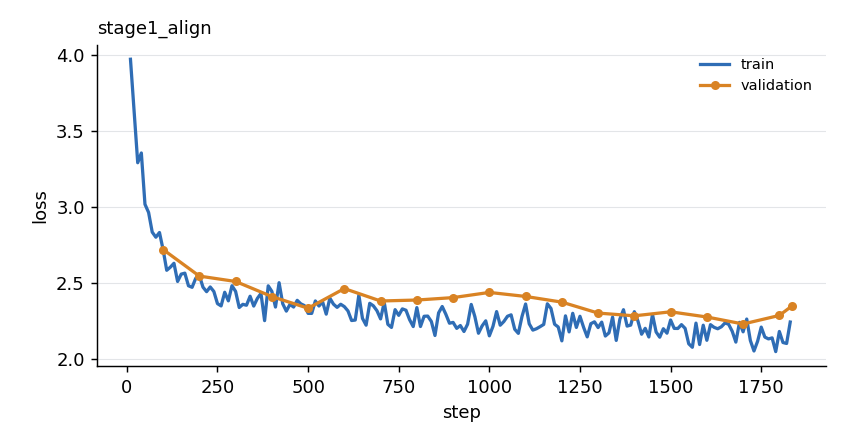
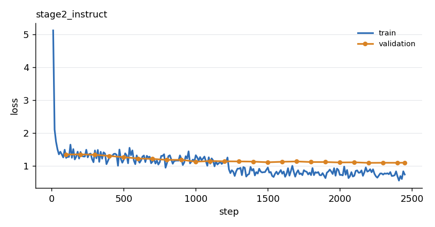

# Phase 4 Results: Two-stage training and baseline evaluation

Stage 1 aligns the projector on captions; stage 2 trains the projector and LoRA adapters on VQA. Setup common to both: CLIP ViT-B/16 (frozen, layer -2, cached features), Qwen2.5-0.5B-Instruct, linear projector, 64 visual tokens, bf16, batch 16, one seed, local Apple M4 Pro (MPS).

## Headline

| Model | VQA accuracy | yes/no | number | other | Caption BLEU-4 | Caption CIDEr | Avg caption words |
|---|---|---|---|---|---|---|---|
| Always answer "yes" | 24.68% | 66.05% | 0.23% | 1.28% | n/a | n/a | n/a |
| Text-only (no image) | 24.35% | 43.45% | 11.90% | 13.85% | n/a | n/a | n/a |
| Untrained projector | 18.63% | 28.56% | 13.56% | 12.80% | 0.011 | 0.001 | 31.8 |
| Stage 1 (captions) | 4.41% | 0.08% | 0.56% | 8.49% | **0.262** | **0.946** | 10.0 |
| **Stage 2 (VQA)** | **57.36%** | **79.31%** | **38.74%** | **46.39%** | 0.003 | 0.272 | 2.0 |

Held-out data: 3,000 VQAv2 questions and 1,000 captioned images, none of whose images appear in training. VQA accuracy is the official soft metric (see `src/eval/vqa_accuracy.py`); captions use our BLEU/CIDEr-D, which match `pycocoevalcap` on identical tokenised text (tokenisation is simpler than the official Java tokenizer, so numbers are comparable between our models but not to published ones).

With 3,000 questions the standard error of an accuracy near 57% is about 0.9 points (95% interval roughly +/- 1.8). Differences of a point or two between runs are within noise; everything here is a single seed.

**Phase 4 exit criterion met:** stage 2 beats stage 1 on VQA by a wide margin (57.4% vs 4.4%), and, more meaningfully, beats the best language-only baseline (24.7%) by 33 points.

## What the baselines establish

- **The language prior is strong.** Answering "yes" to everything scores 24.7%, and the text-only LM scores the same. Any VQA number below ~25% is no evidence of using the image.
- **Random visual tokens are noise.** The untrained projector scores below text-only (18.6% vs 24.4%) and produces 32-word hallucinated captions (CIDEr 0.001).
- **Stage 2's gains are where priors cannot help.** "Other" (colours, objects) rose from 14% (text-only) to 46%, and number from 12% to 39%, categories where "yes" scores ~0 and the language model alone is weak.

## Stage 1: alignment (captions only)



- Config `configs/stage1_align.yaml`: projector only (0.69M params), 10k caption images (9,800 train / 200 validation images), lr 3e-3 cosine with 5% warmup, 3 epochs = 1,836 steps, median 1.8 s/step (about 55 min).
- Pilot (200 steps each, validation loss): lr 3e-4 -> 2.89, 1e-3 -> 2.69, 3e-3 -> 2.58 (fp32), and 1e-3 bf16 -> 2.59 vs 2.69 fp32. 3e-3 and bf16 were chosen; a longer run at a lower rate was not tried.
- Validation loss falls from 2.72 to ~2.3 by step 500-1,000 and then plateaus (best 2.2325 at step 1,700, 2.353 at the end) while train loss keeps drifting down: mild overfitting, and the 200-image validation set is noisy. The best checkpoint was evaluated.
- Result: captions go from rambling (31.8 words, CIDEr 0.001) to image-grounded one-liners (10.0 words, BLEU-4 0.262, CIDEr 0.946). Examples: "A sandwich with a lettuce leaf and tomato on it", "A vase filled with yellow and white flowers".
- **Why VQA is 4.4%:** the model only saw caption targets, so it answers questions with captions or repeats the question ("Is this a real game?" -> "A game of football on a grass field"). Only 19% of its answers are one word. It does read the image ("What color is the ground?" -> "The grass is green.") but does not follow the question format. This is expected, not a defect.

## Stage 2: instruction tuning (VQA)



- Config `configs/stage2_instruct.yaml`: projector initialised from stage 1 (lr 3e-4) plus LoRA r=16, alpha 32 on all attention and MLP linears of the LM (8.80M params, lr 2e-4), 20k questions (19,600 train / 400 validation, split by image), 2 epochs = 2,450 steps, median 2.6 s/step (about 1.8 h). Learning rates were not piloted.
- Validation loss 1.34 (step 100) -> 1.09 (best 1.0859 at step 2,200; 1.091 at the end).
- **Overfitting in epoch 2:** train loss steps down at the epoch boundary (about 1.1 -> 0.8) while validation loss stays flat at ~1.1: the second pass is mostly memorising. One epoch plus a lower learning rate may give nearly the same accuracy; not tested.
- The run was interrupted once (at step ~2,060, after the step-2,000 checkpoint) and resumed from checkpoint. The interim step-2,000 model scored 56.92%, the final one 57.36%, so the last 450 steps changed little.

### VQA by question type (stage 2, eight most common types)

| Question type | Accuracy | n |
|---|---|---|
| is this | 81.3% | 98 |
| is the | 73.3% | 229 |
| none of the above | 62.2% | 142 |
| what color is the | 55.8% | 208 |
| what kind of | 55.0% | 100 |
| how many | 41.7% | 286 |
| what is the | 40.9% | 173 |
| what | 37.5% | 209 |

Counting ("how many") and open-ended object questions are the weakest large groups; Phase 6 analyses them further.

### Cost of stage 2 for captioning

Caption CIDEr falls from 0.946 to 0.272 and captions shrink to ~2 words: with VQA-only training the model answers everything in short phrases. The demo therefore uses the stage 1 checkpoint for captions. A mixed caption + VQA stage 2 would address this; not done.

## Demo on images outside COCO (`scripts/demo.py`)

Scored by looking at the images.

| Image | Question | Answer | Correct |
|---|---|---|---|
| Orange cat close-up (Wikimedia) | What animal or object is in the picture? / What color is it? / Is this indoors? | cat / orange / no | 3 of 3 |
| Bicycle on a street (Wikimedia) | same | bike / blue / no | 2 of 3 (the bike is black) |
| Red square on white (synthetic) | colour of shape / shape / count / background | red / heart / 2 / red | 1 of 4 |
| Three blue circles on yellow | same | yellow / square / 4 / yellow | 1 of 4 |
| Orange triangle on green | same | orange / star / 10 / green | 2 of 4 |

Captions (stage 1): cat photo "A cat with a white puffy tail." (cat right, tail invented); bicycle "A bike is parked in front of a car." (plausible). Ordinary photos and colours work; naming geometric shapes (0 of 3) and counting (0 of 3) fail, matching the weak spots in the held-out breakdown. These images are few and the shapes are far from COCO photos; this is an anecdote, not a measurement.

## Speed (MPS, batch 32 evaluation, bf16)

| | ms per question/image | Notes |
|---|---|---|
| Text-only VQA | 21 | no image tokens |
| Stage 2 VQA | 26 | 64 image tokens + short answer |
| Stage 1 captions | 30 | ~10 generated words |
| Untrained captions | 111 | 32 generated words |

Training: 1.8 s/step (stage 1, batch 16, 64 tokens) and 2.6 s/step (stage 2, LoRA). Training used cached ViT features, which removes the image pipeline from every step (142x faster per batch of images in isolation; the LM dominates the step).

## Problems found and fixed in Phase 4

1. **Unanimous-answer scoring penalised formatting.** The official script only normalises when annotators disagree, so "four" scored 0 against ten "4"s. Evaluation now normalises always (`normalize="always"`, as the challenge server does); the official mode is kept and tested. Baselines were rescored from saved predictions.
2. **`get_device` turned an already-resolved device into CPU**, crashing evaluation; fixed with a regression test.
3. **A background run exit code hid a killed process.** The stage 2 run died at step ~2,060 while the shell reported exit code 0 (the code came from the trailing `grep`). Found by checking the checkpoint step; the run was resumed and finished. Long runs are now logged to a file with the trainer's own exit code.
4. **Evaluation precision is explicit:** models trained in bf16 are evaluated in bf16 by default, and `--dtype` overrides it.

## Reproduce

```bash
python -m pytest                                                  # 225 tests
python -m scripts.extract_features                                # ViT feature cache (needs data/, see docs/data.md)
python -m src.train --config configs/stage1_align.yaml            # ~55 min
python -m src.train --config configs/stage2_instruct.yaml         # ~1.8 h
python -m scripts.evaluate --name stage1 --checkpoint checkpoints/stage1_align/best.pt
python -m scripts.evaluate --name stage2 --checkpoint checkpoints/stage2_instruct/best.pt
python -m scripts.evaluate --name text_only --text-only
python -m scripts.evaluate --name untrained
python -m scripts.evaluate --name constant_yes --constant yes
python -m scripts.demo --image photo.jpg -q "What color is the car?"
```

Checkpoints (`checkpoints/`) and results (`results/`) are git-ignored; the numbers above are copied from `results/*/{vqa,caption}_metrics.json`. A run is reproducible from its config up to nondeterminism on MPS.
